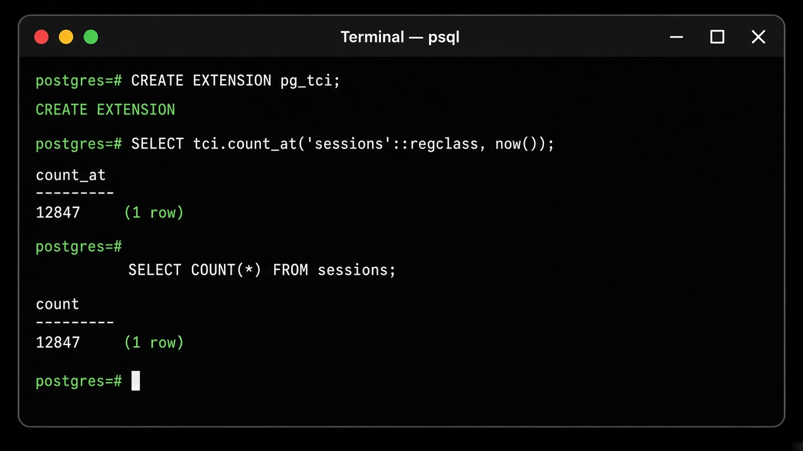
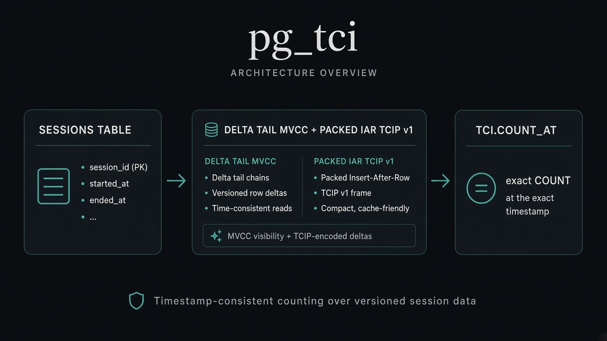
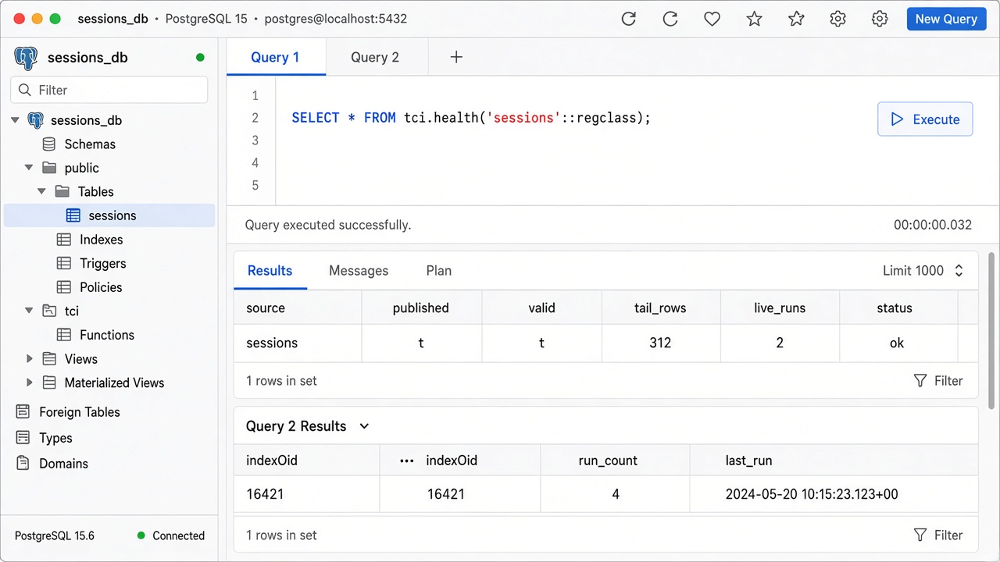
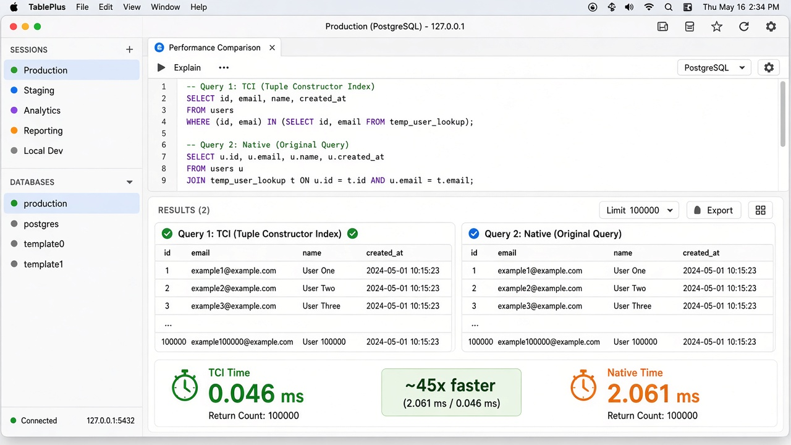

# pg_tci

**Temporal Coverage Index** — free open-source PostgreSQL extension for
**exact** point-in-time interval coverage `COUNT`.

> **0.1.12 · external preview** · [PostgreSQL License](LICENSE)  
> Not production GA. See [`docs/when-not-to-use.md`](docs/when-not-to-use.md).



```sql
SELECT tci.count_at('sessions'::regclass, timestamptz '2024-06-01 12:00+00');
```

Interval semantics: **`[start_at, end_at)`**. `NULL end_at` means open-ended.

Not an Index AM and not a planner rewrite — call `tci.count_at*` explicitly.

## How it works



A published index answers from packed TCIP v1 aggregates plus a small MVCC
delta tail, merged under the caller’s snapshot. Invalid indexes **fail closed**
to native `COUNT`.

## Install

Requires **PostgreSQL 18** and superuser.

```bash
export PG_CONFIG=$(which pg_config)
make clean && make && make install
```

```sql
CREATE EXTENSION pg_tci;
```

Linux binaries: [Releases](https://github.com/hghukasyan/pg_tci/releases).

## Quickstart

```sql
CREATE TABLE sessions (
  id bigserial PRIMARY KEY,
  started_at timestamptz NOT NULL,
  ended_at   timestamptz
);

SELECT tci.create('sessions'::regclass, 'started_at', 'ended_at');
SELECT tci.count_at('sessions'::regclass, now());
SELECT * FROM tci.stats('sessions'::regclass);
```

Filtered equality (registered keys only):

```sql
SELECT tci.create_filtered(
  'sessions'::regclass, 'started_at', 'ended_at', 'segment', 'enterprise');
SELECT tci.count_at_filtered(
  'sessions'::regclass, now(), 'segment', 'enterprise');
```

## Monitoring



```sql
SELECT * FROM tci.health('sessions'::regclass);
SELECT tci.seal_bounded('sessions'::regclass, 8192);
SELECT tci.compact_pairwise('sessions'::regclass);
SELECT * FROM tci.maintain('sessions'::regclass);
```

Optional bgworker: `shared_preload_libraries = 'pg_tci'` and
`pg_tci.enable_maintenance_worker = on`.  
Cron example: [`examples/maintain_cron.sh`](examples/maintain_cron.sh).

## Performance (representative)



Numbers and reproduction: [`docs/benchmarks.md`](docs/benchmarks.md).

## Docs

| | |
|--|--|
| [`docs/quickstart.md`](docs/quickstart.md) | Getting started |
| [`docs/api.md`](docs/api.md) | Public API |
| [`docs/architecture.md`](docs/architecture.md) | Design |
| [`docs/operations.md`](docs/operations.md) | Ops / maintenance |
| [`docs/limitations.md`](docs/limitations.md) | Limits |
| [`docs/benchmarks.md`](docs/benchmarks.md) | Numbers |
| [`docs/when-not-to-use.md`](docs/when-not-to-use.md) | Fit filter |
| [`CHANGELOG.md`](CHANGELOG.md) | Release notes |

## Tests

```bash
make installcheck
```

## License

[PostgreSQL License](LICENSE) · [`SECURITY.md`](SECURITY.md) · [`CONTRIBUTING.md`](CONTRIBUTING.md)
