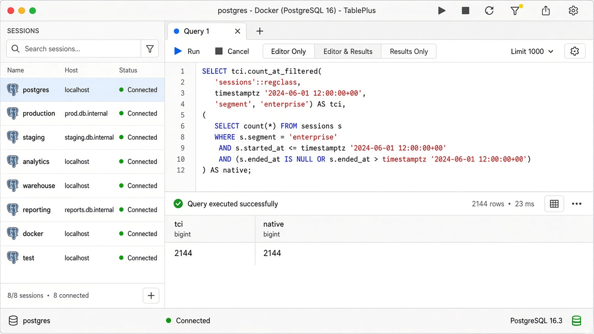

# pg_tci

PostgreSQL extension for exact coverage counts over time intervals.

Version **0.1.12** (external preview, PostgreSQL License). Not production GA.
If your workload is a bad fit, read [`docs/when-not-to-use.md`](docs/when-not-to-use.md) first.

`tci.count_at` and a plain `COUNT(*)` on the same snapshot:


```sql
SELECT tci.count_at('sessions'::regclass, timestamptz '2024-06-01 12:00+00');
```

Intervals are `[start_at, end_at)`. `NULL end_at` means still open.

This is not an Index AM and does not rewrite planner queries. You call
`tci.count_at*` yourself.

## How it works


Published indexes answer from packed TCIP v1 runs plus a small MVCC delta tail,
under the caller's snapshot. If the index is invalid or unpublished, the API
falls back to native `COUNT` instead of returning a stale packed total.

## Install

Needs PostgreSQL 18 and a superuser install.

```bash
export PG_CONFIG=$(which pg_config)
make clean && make && make install
```

```sql
CREATE EXTENSION pg_tci;
```

Linux tarballs are on [Releases](https://github.com/hghukasyan/pg_tci/releases).

## Quickstart

```sql
CREATE TABLE sessions (
  id bigserial PRIMARY KEY,
  started_at timestamptz NOT NULL,
  ended_at   timestamptz
);

SELECT tci.create('sessions'::regclass, 'started_at', 'ended_at');
SELECT tci.count_at('sessions'::regclass, now());
SELECT * FROM tci.stats('sessions'::regclass);
```

### Filtered counts

Only registered equality filters (no free-form `WHERE`). Here both sides return
2144:



```sql
SELECT tci.create_filtered(
  'sessions'::regclass, 'started_at', 'ended_at', 'segment', 'enterprise');
SELECT tci.count_at_filtered(
  'sessions'::regclass, timestamptz '2024-06-01 12:00+00',
  'segment', 'enterprise');
```

## Monitoring


```sql
SELECT * FROM tci.health('sessions'::regclass);
SELECT tci.seal_bounded('sessions'::regclass, 8192);
SELECT tci.compact_pairwise('sessions'::regclass);
SELECT * FROM tci.maintain('sessions'::regclass);
```

Optional bgworker: set `shared_preload_libraries = 'pg_tci'` and
`pg_tci.enable_maintenance_worker = on`.
Cron sample: [`examples/maintain_cron.sh`](examples/maintain_cron.sh).

## Performance

Warm COUNT on ~100k intervals. Same answer (`100000`), very different latency:

| | result | time |
|--|--:|--:|
| **`tci.count_at`** | 100000 | **0.046 ms** |
| native `COUNT(*)` | 100000 | **2.061 ms** |

**~45x faster** on that cell (**0.046 ms** vs **2.061 ms**).


Other cells (also ms):

| cell | TCI | native |
|--|--:|--:|
| ~100k warm COUNT | **~0.046 ms** | **~2.06 ms** |
| 1M, 50 readers, read-only | **~31 ms** | **~580 ms** |
| 1M, 50 readers + ~5k writes/s | **~338 ms** | **~926 ms** |

Details and how to reproduce: [`docs/benchmarks.md`](docs/benchmarks.md).

## Docs

- [`docs/quickstart.md`](docs/quickstart.md)
- [`docs/api.md`](docs/api.md)
- [`docs/architecture.md`](docs/architecture.md)
- [`docs/operations.md`](docs/operations.md)
- [`docs/limitations.md`](docs/limitations.md)
- [`docs/benchmarks.md`](docs/benchmarks.md)
- [`docs/when-not-to-use.md`](docs/when-not-to-use.md)
- [`CHANGELOG.md`](CHANGELOG.md)

## Tests

```bash
make installcheck
```

## License

[PostgreSQL License](LICENSE). See also [`SECURITY.md`](SECURITY.md) and
[`CONTRIBUTING.md`](CONTRIBUTING.md).
